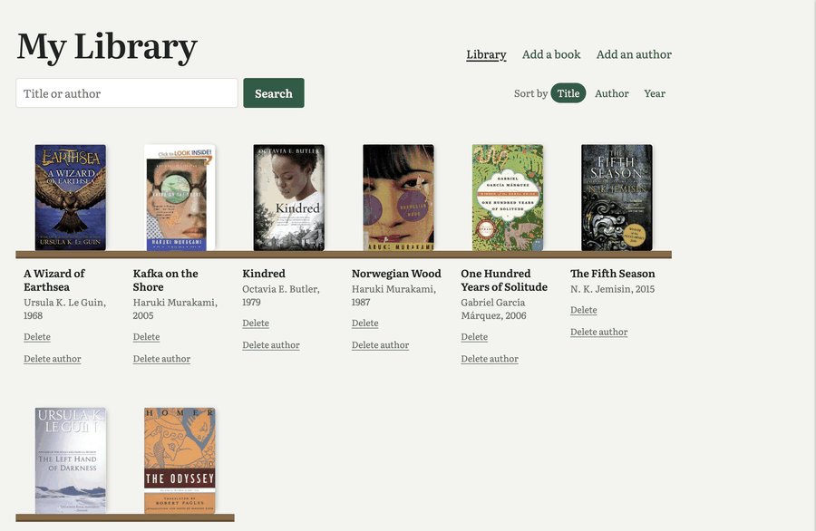
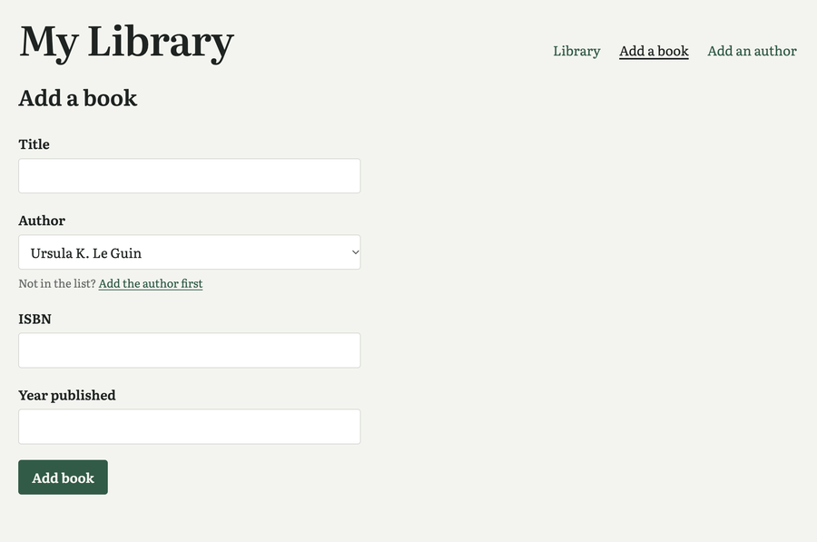
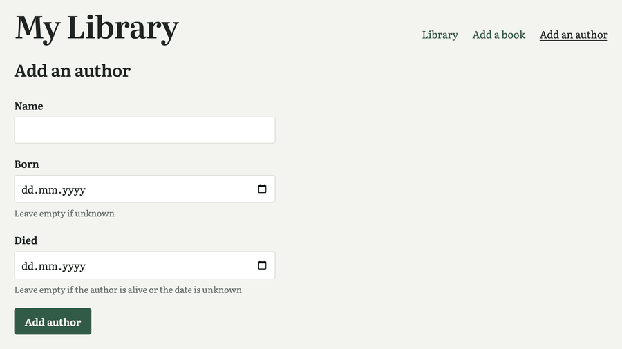

# Flask Digital Library

A small web app for keeping track of the books I own and their authors, built with
Flask and Flask-SQLAlchemy on a SQLite database.

## Screenshots

<p>
  <a href="docs/home.png"></a>
  <a href="docs/add-book.png"></a>
  <a href="docs/add-author.png"></a>
</p>

## Features

- Add authors (birth and death dates are optional) and books (with an author dropdown)
- Browse the library as a bookshelf with cover images from the
  [Open Library Covers API](https://openlibrary.org/dev/docs/api/covers)
- Search books by title or author name
- Sort by title, author or publishing year
- Delete a book, or delete an author together with all of their books
- Input validation: required fields, numeric year, existing author, normalized
  and unique ISBNs

## Tech stack

- Python 3.13, Flask, Flask-SQLAlchemy (SQLAlchemy 2.x)
- SQLite
- Jinja2 templates and plain CSS
- [uv](https://docs.astral.sh/uv/) for dependencies, [Ruff](https://docs.astral.sh/ruff/) for linting and formatting

## Getting started

```bash
git clone git@github.com:thatAxelGuy/flask-digital-library.git
cd flask-digital-library
uv sync
uv run flask --app app run --debug
```

Then open <http://127.0.0.1:5000>. The database (`data/library.sqlite`) and its
tables are created automatically on first start.

Without uv, install the dependencies with pip instead (Python 3.10 or newer):

```bash
pip install -r requirements.txt
flask run
```

## Project structure

```
app.py            Flask app and routes
data_models.py    SQLAlchemy models: Author and Book
templates/        Jinja templates (home, add book, add author)
static/           Stylesheet
```

## Routes

| Route | Method | Purpose |
|---|---|---|
| `/` | GET | Library; `?q=` to search, `?sort=title\|author\|year` to sort |
| `/add_author` | GET, POST | Form to add an author |
| `/add_book` | GET, POST | Form to add a book |
| `/book/<id>/delete` | POST | Delete a book |
| `/author/<id>/delete` | POST | Delete an author and all their books |

## Notes

- This is a school project meant to run locally. It has no user accounts or CSRF
  protection, so it should not be deployed publicly as is.
- Changing a model does not update an existing database. During development,
  delete `data/library.sqlite` and restart the app to recreate the tables.

## License

MIT, see [LICENSE](LICENSE).
